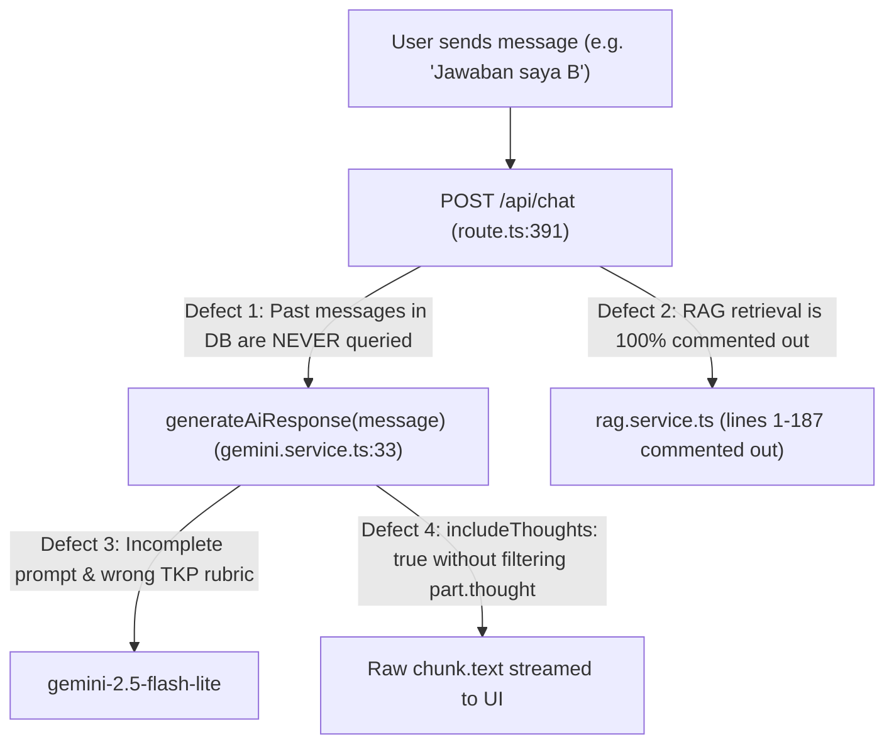

# SKD CPNS Learning Chatbot — Audit & AI Response Quality Improvement Plan

## 1. Current Project Inventory & Halted State Diagnosis

The repository is a **Next.js 15 (App Router) + PostgreSQL (`pgvector`) + Drizzle ORM + Google Gemini (`@google/genai`)** application originally built as *"Portal Informasi Publik Kabupaten Madiun"* and partially converted into an **SKD CPNS Learning Chatbot**.

### Working Features
- **Hybrid Chat Persistence**: `POST /api/chat` ([route.ts](file:///home/illufoxkusanagi/Documents/SKD-learning-chatbot/src/app/api/chat/route.ts#L199-L427)) supports authenticated users (NextAuth Credentials in [auth.ts](file:///home/illufoxkusanagi/Documents/SKD-learning-chatbot/src/lib/auth.ts#L8-L72)) and 24-hour guest sessions (`isGuestChat`, `expiresAt`).
- **Streaming Chat UI**: [use-chat.ts](file:///home/illufoxkusanagi/Documents/SKD-learning-chatbot/src/hooks/use-chat.ts#L102-L202) and [chat/page.tsx](file:///home/illufoxkusanagi/Documents/SKD-learning-chatbot/src/app/chat/page.tsx#L46-L131) stream responses and render Markdown (`react-markdown`).
- **Conversation History CRUD**: Sidebar conversation list, title editing, and deletion via `/api/chat/history`, `/api/chat/[chatId]`, and `/api/chat/title/[chatId]`.

### Root Causes of Unreliable AI Responses & Halted Progress

| #     | Defect                                                              | Exact Location                                                                                                                                                                                                                                                                                                                                                                                                                                                                                                                                                                     | Impact on AI Quality / Reliability                                                                                                                                                                                                                                                                                                                                        |
| ----- | ------------------------------------------------------------------- | ---------------------------------------------------------------------------------------------------------------------------------------------------------------------------------------------------------------------------------------------------------------------------------------------------------------------------------------------------------------------------------------------------------------------------------------------------------------------------------------------------------------------------------------------------------------------------------- | ------------------------------------------------------------------------------------------------------------------------------------------------------------------------------------------------------------------------------------------------------------------------------------------------------------------------------------------------------------------------- |
| **1** | **100% Stateless AI Calls (Zero Conversation Memory)**              | [src/app/api/chat/route.ts](file:///home/illufoxkusanagi/Documents/SKD-learning-chatbot/src/app/api/chat/route.ts#L391), [src/lib/services/ai/gemini.service.ts](file:///home/illufoxkusanagi/Documents/SKD-learning-chatbot/src/lib/services/ai/gemini.service.ts#L33-L53)                                                                                                                                                                                                                                                                                                        | `generateAiResponse(message)` only receives the latest string. When the tutor gives a practice question and the user answers `"B"` or asks a follow-up, Gemini has no memory of the question it just generated.                                                                                                                                                           |
| **2** | **RAG Completely Commented Out & Polluted with Madiun Legacy Code** | [src/lib/services/ai/rag.service.ts](file:///home/illufoxkusanagi/Documents/SKD-learning-chatbot/src/lib/services/ai/rag.service.ts#L1-L187), [src/app/api/chat/route.ts](file:///home/illufoxkusanagi/Documents/SKD-learning-chatbot/src/app/api/chat/route.ts#L3), [dynamic-embedding-cache.service.ts](file:///home/illufoxkusanagi/Documents/SKD-learning-chatbot/src/lib/services/ai/dynamic-embedding-cache.service.ts#L155), [api-client.service.ts](file:///home/illufoxkusanagi/Documents/SKD-learning-chatbot/src/lib/services/external/api-client.service.ts#L130-L139) | `rag.service.ts` is 100% commented out. The dormant cache service fetches Madiun weather/news with a hardcoded fake score (`similarity: 0.8`). Zero SKD CPNS material exists in `rag_data`, and `scripts/seed.ts` referenced in [package.json](file:///home/illufoxkusanagi/Documents/SKD-learning-chatbot/package.json#L10) is missing.                                  |
| **3** | **Flawed SKD System Prompt & Invalid TKP Scoring Rubric**           | [src/lib/services/ai/gemini.service.ts](file:///home/illufoxkusanagi/Documents/SKD-learning-chatbot/src/lib/services/ai/gemini.service.ts#L35-L53)                                                                                                                                                                                                                                                                                                                                                                                                                                 | (a) Line 47 is an unfinished sentence fragment; (b) System prompt is concatenated into `contents` instead of `config.systemInstruction`; (c) Prompt forces binary right/wrong explanations, which is wrong for **TKP** (graduated 1–5 score across all 5 options A–E) and lacks official SKD kisi-kisi (TWK, TIU, TKP) and passing grade rules (TWK 65, TIU 80, TKP 166). |
| **4** | **Thinking Scratchpad Leakage & Embedding Fragility**               | [src/lib/services/ai/gemini.service.ts](file:///home/illufoxkusanagi/Documents/SKD-learning-chatbot/src/lib/services/ai/gemini.service.ts#L59-L70), [src/lib/services/ai/embeddings.service.ts](file:///home/illufoxkusanagi/Documents/SKD-learning-chatbot/src/lib/services/ai/embeddings.service.ts#L5-L44)                                                                                                                                                                                                                                                                      | `thinkingConfig: { includeThoughts: true }` streams raw `chunk.text` without filtering out thought parts (`part.thought`). Top-level `throw` when `GEMINI_API_KEY` is missing breaks builds.                                                                                                                                                                              |
| **5** | **Missing Vector Index & Unfinished Branding / Dead UI Buttons**    | [src/lib/db/schema.ts](file:///home/illufoxkusanagi/Documents/SKD-learning-chatbot/src/lib/db/schema.ts#L36-L56), [app-sidebar.tsx](file:///home/illufoxkusanagi/Documents/SKD-learning-chatbot/src/components/ui/app-sidebar.tsx#L24-L26), [help-section.ts](file:///home/illufoxkusanagi/Documents/SKD-learning-chatbot/src/lib/datas/help-section.ts#L28), [chat-input.tsx](file:///home/illufoxkusanagi/Documents/SKD-learning-chatbot/src/components/chat/chat-input.tsx#L48-L56)                                                                                             | `rag_data` has no HNSW index; sidebar still says *"Portal Informasi Publik"*; `help-section.ts` describes Kabupaten Madiun; `chat-input.tsx` "FAQ" and "Saran" buttons have no handlers.                                                                                                                                                                                  |

---

## 2. Proposed Architecture for High-Quality SKD AI Responses

> [!IMPORTANT]
> Every change below is designed for real production execution (real PostgreSQL `pgvector` retrieval, real multi-turn history injection, real SKD CPNS curriculum seed data, and zero fake similarity scores).

### Phase 1: Multi-Turn Conversation Memory & Gemini Pipeline Overhaul
1. **[src/lib/services/ai/gemini.service.ts](file:///home/illufoxkusanagi/Documents/SKD-learning-chatbot/src/lib/services/ai/gemini.service.ts#L1-L76)**
   - Move the SKD system prompt into `config.systemInstruction` instead of concatenating it into the user message string.
   - Replace the broken prompt with a comprehensive **SKD CPNS Curriculum & Pedagogical System Instruction** covering:
     - **TWK (Tes Wawasan Kebangsaan)**: Nasionalisme, Integritas, Bela Negara, Pilar Negara (Pancasila, UUD 1945, NKRI, Bhinneka Tunggal Ika), Bahasa Negara — binary scoring (+5 correct, 0 wrong), citing exact articles/laws when relevant.
     - **TIU (Tes Inteligensia Umum)**: Verbal (Analogi, Silogisme, Analitis), Numerik (Berhitung, Deret Angka, Perbandingan Kuantitatif, Soal Cerita), Figural (deskripsi pola) — binary scoring (+5/0) with step-by-step logical/mathematical derivation and fast-solving tips (*trik cepat*).
     - **TKP (Tes Karakteristik Pribadi)**: Pelayanan Publik, Jejaring Kerja, Sosial Budaya, TIK, Profesionalisme, Anti-Radikalisme — **graduated 1–5 point breakdown for every option (A–E)** explaining why the 5-point option aligns best with ASN core values (*BerAKHLAK*).
   - Update `generateAiResponse(userMessage, history, ragContext)` to accept structured multi-turn `history` (`Content[]` with roles `"user"` and `"model"`) and retrieved `ragContext`.
   - Filter out internal reasoning tokens (`part.thought === true`) when streaming response chunks so only final answer text reaches the client, and set an appropriate `temperature` (`0.3`–`0.4` for factual/analytical tutoring consistency).
   - Defer API key validation to call time instead of throwing at module import time.

2. **[src/app/api/chat/route.ts](file:///home/illufoxkusanagi/Documents/SKD-learning-chatbot/src/app/api/chat/route.ts#L98-L426)**
   - Before calling `generateAiResponse`, fetch the recent conversation messages (e.g., last 20 messages ordered chronologically) from `messages` table for `conversationId`.
   - Query `findRelevantContents(message)` from `rag.service.ts` to retrieve relevant SKD material/questions and pass both `history` and `ragContext` into `generateAiResponse`.
   - Remove the commented-out legacy blocks (lines 98–185).

### Phase 2: Real SKD RAG Pipeline, Vector Index & Seed Knowledge Base
1. **[src/lib/services/ai/rag.service.ts](file:///home/illufoxkusanagi/Documents/SKD-learning-chatbot/src/lib/services/ai/rag.service.ts#L1-L187)**
   - Uncomment and rewrite `rag.service.ts` to perform clean cosine similarity search (`1 - (rag_data.embedding <=> query_embedding)`) against `rag_data` with optional category filtering (`TWK`, `TIU`, `TKP`), returning structured context blocks with title, category, subtopic, content, and similarity score.
2. **[src/lib/services/ai/dynamic-embedding-cache.service.ts](file:///home/illufoxkusanagi/Documents/SKD-learning-chatbot/src/lib/services/ai/dynamic-embedding-cache.service.ts#L1-L265)** & **[src/lib/services/external/api-client.service.ts](file:///home/illufoxkusanagi/Documents/SKD-learning-chatbot/src/lib/services/external/api-client.service.ts#L1-L415)**
   - Remove the fake `similarity: 0.8` injection and Madiun weather/holiday/country API triggers from the SKD RAG flow.
3. **[src/lib/services/ai/embeddings.service.ts](file:///home/illufoxkusanagi/Documents/SKD-learning-chatbot/src/lib/services/ai/embeddings.service.ts#L1-L76)**
   - Normalize text without destructive lowercasing where case matters (acronyms like `TWK`, `TIU`, `TKP`, `UUD 1945`, `BPUPKI`, `PPKI`), support `taskType` (`RETRIEVAL_DOCUMENT` vs `RETRIEVAL_QUERY`), and enforce `outputDimensionality: 768`.
4. **[src/lib/db/schema.ts](file:///home/illufoxkusanagi/Documents/SKD-learning-chatbot/src/lib/db/schema.ts#L36-L56)**
   - Add an HNSW cosine index on `rag_data.embedding` (`index("rag_data_embedding_idx").using("hnsw", table.embedding.op("vector_cosine_ops"))`).
5. **`scripts/seed.ts` & `src/lib/datas/skd-knowledge.ts` (New Files)**
   - Create a curated SKD CPNS dataset (`src/lib/datas/skd-knowledge.ts`) covering official KepmenPANRB kisi-kisi, passing grades, TWK/TIU/TKP concept summaries, and benchmark HOTS practice questions with full rubrics.
   - Implement `scripts/seed.ts` (matching `"db:seed": "tsx scripts/seed.ts"` in [package.json](file:///home/illufoxkusanagi/Documents/SKD-learning-chatbot/package.json#L10)) to generate embeddings and populate `rag_data`.

### Phase 3: SKD Branding Alignment, Quick-Action Prompts & `.env.example`
1. **[src/components/ui/app-sidebar.tsx](file:///home/illufoxkusanagi/Documents/SKD-learning-chatbot/src/components/ui/app-sidebar.tsx#L24-L26,L101-L103)**
   - Fix `ChatHistoryItem` types (`id: string`, `userId: string | null`) to match UUID schema and update header title from `"Portal Informasi Publik"` to `"Tutor SKD CPNS"`.
2. **[src/lib/datas/help-section.ts](file:///home/illufoxkusanagi/Documents/SKD-learning-chatbot/src/lib/datas/help-section.ts#L1-L94)** & **[src/app/layout.tsx](file:///home/illufoxkusanagi/Documents/SKD-learning-chatbot/src/app/layout.tsx#L7-L22)**
   - Replace Madiun Regency portal FAQ content with SKD CPNS Tutor FAQ (how to practice TWK/TIU/TKP, scoring system, passing grades, HOTS tips).
3. **[src/components/chat/chat-input.tsx](file:///home/illufoxkusanagi/Documents/SKD-learning-chatbot/src/components/chat/chat-input.tsx#L48-L56)**
   - Wire the `"FAQ"` button to navigate to `/help` and the `"Saran"` button to insert/trigger quick SKD practice prompts (e.g., *"Berikan 1 soal HOTS TWK, TIU, atau TKP"*).
4. **`.env.example` (New File)**
   - Declare all required environment variables (`DATABASE_URL`, `GEMINI_API_KEY`, `GENERATIVE_MODEL`, `EMBEDDING_MODEL`, `NEXTAUTH_SECRET`, `NEXTAUTH_URL`, `RAG_SIMILARITY_THRESHOLD`, `RAG_MAX_RESULTS`).
